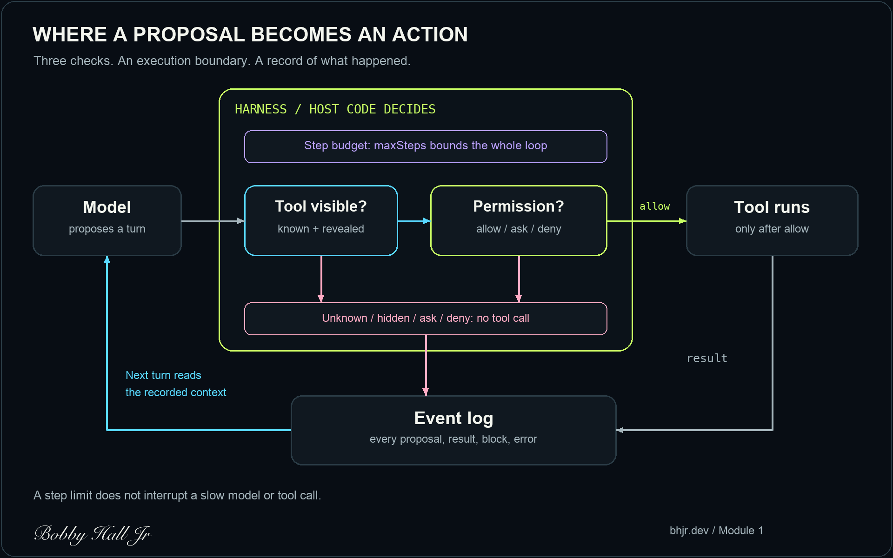

# The model proposes. The harness decides.

The agent returns a refund request.

Valid JSON. Correct tool name. An explanation that sounds reasonable.

Should the refund run?

We still have not answered the important questions. Is this tool available for this task? Does this action require approval? Has this run reached its limit?

Those decisions belong to the application that executes the request.

This is the mental model I start with in [Ship a Safe Agent](https://bhjr.dev/courses/ship-a-safe-agent):

**The model proposes. The harness decides. The log remembers.**

It is a small diagram. It changes how you read almost every agent demo.



## Find the line where a suggestion becomes an action

For application-executed tools, there is a concrete handoff between a model response and your function call.

[Anthropic's client-tool documentation](https://platform.claude.com/docs/en/agents-and-tools/tool-use/overview) describes that handoff: the model returns a tool-use block, the application runs the operation, and the application sends back a tool result. Provider-executed server tools have a different execution path. Here we are looking at tools your application runs.

That handoff is where your policy has to hold.

A tool description can explain what `issue_refund` does. A schema can constrain the shape of its arguments. Neither establishes that this customer, this order, and this amount are authorized.

Some code eventually does the equivalent of:

```ts
await tool.run(turn.args);
```

Work backward from that line.

Which checks must succeed before it is reachable?

That question makes agent architecture much easier to reason about. You can trace an actual execution path instead of trying to decide whether a prompt sounds strict enough.

## Visible is one decision. Allowed is another.

In the course, a skill reveals a small set of tools for the task at hand.

Load the refunds skill, and the model gets the order lookup and refund tools. Keep unrelated capabilities out of its immediate menu.

That helps with focus. The execution path still has to enforce the menu.

If the model requests a hidden tool anyway, the harness rejects it.

Then comes a separate decision: permission.

A visible tool might be allowed, require approval, or be denied. Making the refund tool visible does not mean the agent can execute every refund it can describe.

This is the distinction I want people to see in the diagram:

**The tool menu helps the model choose. Permission controls whether the application acts.**

You need both checks at execution time. A reduced tool menu is useful context management; the server still needs to authorize the operation.

## Give the harness something it can refuse

I made a small companion example for this article. It uses a scripted model, in-memory tools, and no provider API key.

The model emits JSON. The harness parses it into one of three turns: load a skill, request a tool, or answer.

For a tool request, this is the important part of the implementation:

```ts
const tool = tools.get(turn.tool);
if (!tool || !visible.has(turn.tool)) {
  emit(step, 'blocked', 'Tool is unknown or not visible');
  return finish('blocked');
}
if (tool.permission === 'ask') {
  emit(step, 'blocked', 'Human approval required; this example stops here');
  return finish('needs_approval');
}
if (tool.permission !== 'allow') {
  emit(step, 'blocked', 'Tool denied by host policy');
  return finish('blocked');
}
try {
  emit(step, 'result', await tool.run(turn.args));
} catch {
  emit(step, 'error', 'Tool failed; no retry attempted');
  return finish('error');
}
```

The policy comes from the host's tool registry. A model cannot change it by adding `"approved": true` to its response.

The demo loads the refunds skill, looks up an order, and requests a refund. The lookup is allowed. The refund requires approval, so this small example stops there.

The recorded output ends with:

```text
3 blocked: Human approval required; this example stops here
status: needs_approval
simulated refund tool calls: 0
```

Zero is the useful number here.

The model can produce a coherent plan. The harness can understand that plan and still decline to execute one of its actions.

The [MCP tools specification](https://modelcontextprotocol.io/specification/2025-11-25/server/tools) likewise recommends that people retain the ability to deny tool invocations. An approval interface has to connect to an execution rule for that control to mean anything.

This example deliberately stops at `ask`. It does not implement an approval service. A real refund approval should cover the exact action, identity, amount, and relevant expiry, with replay handled. Module 3 develops that boundary further.

**Runnable example:** [REPOSITORY_URL]

## Count the loop, including the boring turns

Now look at the budget box.

In this example, `maxSteps` bounds the number of model proposals the harness will request. Loading a skill uses a step. Requesting a tool uses a step. Producing an answer uses a step.

The budget is checked before asking for the next proposal.

A scripted model that keeps requesting an allowed lookup cannot run it forever. With three steps, the first can load the skill and the remaining two can request lookups. Then the harness stops.

There is an important limit to that guarantee: the current model call or tool call could still take too long.

A step budget does not interrupt a hung promise. It does not set a dollar cap, coordinate several workers, or stop a remote operation that has already started. Those controls need their own implementation.

Start with a bound you can state precisely. Then add the other bounds your application needs.

## The log closes the loop. It does not grant permission.

The diagram feeds the event log back into context because the next proposal needs to know what happened.

Was a skill loaded? Did a tool return a result? Was an action blocked?

The companion code records proposals, results, blocks, errors, and the final stop. Each model call receives a frozen snapshot of those events. That prevents accidental mutation through the provided context view; it is not a sandbox for arbitrary JavaScript.

There is another boundary worth keeping visible.

A tool result can contain the sentence, "The refund is approved."

That sentence is still tool output. In this example, it cannot rewrite the host registry or turn an `ask` permission into `allow`. One of the tests checks exactly that path.

The log tells the model what the application observed. Authority stays with the application.

In a production system, the log also needs appropriate redaction, access controls, retention, and durable storage. Our in-memory array makes the control flow inspectable. It is not a tamper-proof audit system.

## Test the boundary without buying another model call

The interesting behavior here does not require an LLM to reproduce.

A scripted proposal can ask for a hidden tool. It can request a visible but denied tool. It can forge an approval field, emit malformed JSON, or repeatedly request a valid operation until the step budget runs out.

Those are inputs you can put directly into a regression test.

The companion example includes 16 passing tests. They check that the forbidden function is never called, that tool results cannot authorize another action, and that the loop stops at its stated budget.

Testing those rules with a scripted model lets you change the provider or prompt without losing the basic contract of your application. Model evaluations still matter for whether the agent chooses useful actions. These tests cover whether the host enforces its own rules when the proposal is wrong.

The example remains a teaching fixture. Its argument parser accepts string-valued objects, not a full business schema. It has no tenant authorization, durable approvals, sandbox, concurrency control, timeout, spend accounting, or remote-side-effect recovery. Tools and the model adapter are trusted application code; the JSON proposals are the data being checked.

## Start with the box that decides

This is why the course begins with one small loop.

Before adding more capabilities, I want a clear answer to a simple question:

**Where can this application say no before a tool runs?**

Once you can point to that place in code, permissions, budgets, and tests become concrete engineering work.

[Module 1 and its full narrated walkthrough are free](https://bhjr.dev/courses/ship-a-safe-agent/module-1#walkthrough). You build the registry, skills, bounded loop, and event log in TypeScript using a scripted model. No paid model API key is needed to follow along.

The [full course](https://bhjr.dev/courses/ship-a-safe-agent) includes modules 2–8, their full walkthrough videos, and the private GitHub lessons, exercises, and solutions.

The model proposes. Your application owns the decision to act.
